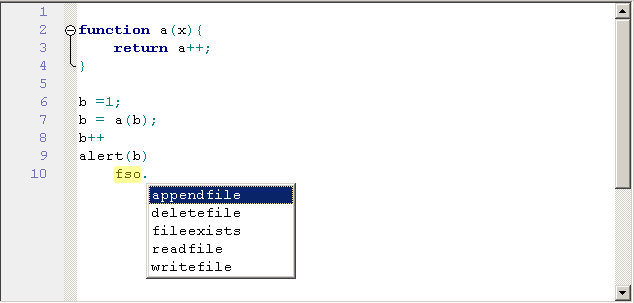

This is an OCX wrapper for the Scintilla source code editor component. 
  

Projects using this:
<ul>
<li><a href="https://github.com/dzzie/duk4vb">Duk4vb JS Debugger</a>, <a href="https://www.youtube.com/watch?v=nSr1-OugQ1M">(Video)</a>
<li>https://github.com/dzzie/YaraWorkBench, <a href="https://www.youtube.com/watch?v=BGnoE_Xs0o4">(Video)</a>
<li>https://github.com/dzzie/IDA_JScript, <a href="https://www.youtube.com/watch?v=R3VuMELfYFU">(Video)</a> 
<li>https://github.com/dzzie/pdfstreamdumper
<li>https://github.com/dzzie/ScriptBasic_Control <a href="https://www.youtube.com/watch?v=KQMvAA_bGdU">(Video)</a> 
<li><a href="http://sandsprite.com/vbdec/">VbDec Pcode Debugger</a>, <a href="https://www.youtube.com/watch?v=SmVmgdcCrDA">(Video)</a>
</ul>

<pre>

This control has been modified from its original. This build has
been termed as SCIVB_LITE and it further simplifies the interface
and use. The orginal project source is included as original.zip

This build is generally compatiable with code written for the 
original except for some rarely used features which have been
removed, or moved into the misc class. In several instances
method names have changed to better describe what it does.

The SciLexer.dll in this build has been updated to current build
3.3.9 and recompiled so that it is compatiable with operating systems
from Win2k forward. (no Encode/DecodePointer imports). 

The following lexers have been compiled in to this build: 

  asm vb vbscript sql cppnocase cpp hypertext xml phpscript

More highlighter files are available in the original.zip

Modification to this build by dzzie@yahoo.com

Credits below:

+---------------------------------------------------------------+
| SCIVB								|
+---------------------------------------------------------------+
| Authors:							|
| Stewart							|
| Stu Collier							|
+---------------------------------------------------------------+
| Purpose:							|
+---------------------------------------------------------------+
| Provide an easy to use interface for VB devlopers wishing to  |
| make use of the Scintilla Source Code component.		|
+---------------------------------------------------------------+

For those of you aware Scintilla is a source editing
component written in C++ and wrapped in the form of a DLL.  It
is available freely from:

  http://www.scintilla.org  

It is updated regularly with new features, bug fixes and enhancements.  

Below are some credit's I would like to list to people who's source
I've used in the process of writing this control.

SCIVB ActiveX Control
----------------------------------------
Stewart		- Co-Author of SCIVB
Stu Collier	- Co-Author of SCIVB
Paul Caton	- Excellent subclassing threw asm class
Steve Mcmahon	- Help plus some subclassing code used in color box.
T De Lange      - Ariel colorbox used in hilight editor

I'm sure there are some others but these are the primary people who 
assisted in this project

</pre>